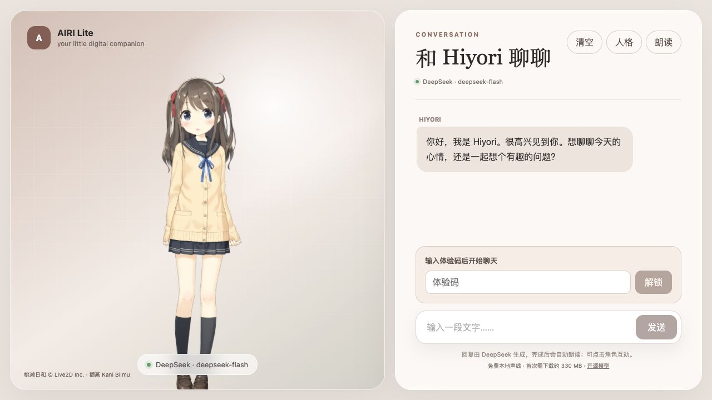

# AIRI Lite

[English](README.md) · [简体中文](README.zh-CN.md)

一个受 [Project AIRI](https://github.com/moeru-ai/airi) 启发的轻量 Live2D 角色聊天 demo：Hiyori Momose、可编辑人格、DeepSeek 流式文字对话和可选中文朗读。不接入麦克风，也不复制 AIRI 的完整架构。

[线上演示](https://mmturingtest.online/airi/)目前需要体验码。仓库的新改动不代表线上已经同步部署。



截图使用 Live2D Inc. 拥有版权的官方样例数据，Hiyori Momose 由 Kani Biimu 绘制。人物素材按 [Live2D 条款](https://www.live2d.com/eula/live2d-sample-model-terms_en.html)单独获取，不包含在本仓库中；本项目独立编写。

## 当前能力

- 可编辑人格和自愿保存的用户记忆；当前标签页保留有大小限制的近期对话。
- 服务端代理 DeepSeek，逐步显示回复；未配置或失败时明确标注本地演示回复。
- 日和还在回答或朗读时，可以直接“打断并发送”下一句；保留已显示的旧片段，不需要先点停止。仅输入草稿不会打断。
- 三个固定 Kokoro 中文声线、轻量系统朗读，以及默认关闭的 MiniMax / ElevenLabs 云端适配器。
- 本地和解码后的云端音频驱动嘴部开合、轻微嘴形变化与表情；播放、暂停和回放沿用同一音频时间轴。
- 云端提供文字时间戳时，在真实发音覆盖区间内从音频起伏预计算稀疏点头；回放和倒拖复用同一轨迹，不均分字符或假装逐音素口型。
- 自动画面策略和可手动保存的节能模式；节能模式限制到 30fps / 1x 绘制分辨率，不重新载入人物或声音。

这里的口型是音量和频谱驱动的近似，并非逐音素对齐。固定 TTS 声线、语速和表情调整也不等于已经验证自然情绪。真实手机性能、云端中文试听效果和长对话的人格质量仍需单独验收。

新增点头保持不超过 0.9° 的小幅度，峰值间隔至少 650ms。没有对齐数据时保留原来的音频起伏回退；有对齐但没有合格峰值时不额外点头。暂停、取消、低开口和减少动态效果设置会抑制动作。详见 [语音节拍验证](docs/verification/2026-10-10-aligned-speech-beats.md)。

插话会先验证输入，再停止旧回合。取消浏览器请求不保证供应商立即停止计算或退回已发生费用；中文输入法候选确认有提交保护，但原生设备输入法仍需实测。详见 [本轮插话验证](docs/verification/2026-10-10-typed-barge-in.md)。

## 本地启动

需要 Node.js 24+、pnpm 10+。在项目目录运行：

```sh
pnpm install
pnpm dev
```

按 [英文说明中的模型准备步骤](README.md#hiyori-momose-model)下载官方 Hiyori 素材。DeepSeek 与可选语音密钥只放在服务端 `.env.local`；参考 `.env.example`，不要使用 `VITE_` 前缀，不要上传密钥、`.data/` 额度记录或人物原始素材。

```sh
pnpm test
pnpm build
```

构建通过不表示真实 API、声音效果或线上部署已验收。

## 语音和性能设置

在界面的设置中选择声线与画面策略。首次使用本地 Kokoro 需要下载较大的模型；轻量模式不下载 Kokoro，但实际声音取决于浏览器和系统声线。云端需要服务端配置和访客明确确认，不会由自动模式偷偷启用。

MiniMax 支持固定的国内 / 国际端点，密钥必须与地区对应。切换地区需要重新确认。供应商返回的 `usage_characters` 才是计费字符数；项目的保护性预留额度不是供应商账单。缺少用量字段不代表免费。详细配置、限额及授权边界见 [英文语音说明](README.md#optional-minimax-voice-paid-disabled-by-default)。

系统朗读未确认开始时，应用会停止等待并提示问题；音频时间停滞时会闭嘴并暂停新的合成预取。这些措施不能检测扬声器音量或保证声音可听见。

## 验证与边界

实现和实际浏览器验证记录位于 [docs/verification](docs/verification)，每份记录注明使用真实服务还是模拟服务，以及尚未验证的部分。模拟回复、合成测试音和单元测试不能替代自然中文试听或真实聊天质量评估。

源代码采用 MIT License。Live2D 样例素材使用其独立条款，不能修改 Hiyori 的人物设计。本项目与 Live2D Inc.、Project AIRI 无官方关联。
